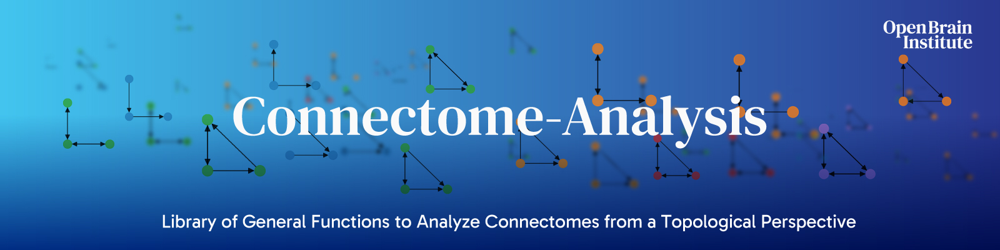

# Connectome Analysis

#### General functions to analyze connectomes from a topological perspective.  



---

## Documentation 

See our [**documentation**](https://connectome-analysis.readthedocs.io/) for detailed explanations including examples and tutorials.

See our [**source code**](src/connalysis) for implementation details.

## Installation

```sh
pip install connectome-analysis
```

Python 3.10 or newer. There are no pinned upper bounds on numpy, scipy or pandas, so the package installs next to
other scientific packages. The graph algorithms come from compiled packages (`flagserpy`, `pyflagsercount` and
`bigrandomgraphs`) that ship wheels for the common platforms; on Python 3.14 and on Linux ARM, where they do not yet,
pip builds them from source and needs a C++ compiler.

Optional extras:

```sh
pip install "connectome-analysis[plot]"   # matplotlib, for the figures of the model building
pip install "connectome-analysis[io]"     # pytables and pyarrow, to read .h5 and .feather neuron tables
pip install "connectome-analysis[all]"    # both
```

---

## Citation  

[](https://doi.org/10.1101/2024.03.15.585196)

If you use this software, kindly use the following BibTeX entry for citation:

```
@article{egas2024efficiency,
  title={Efficiency and reliability in biological neural network architectures},
  author={Egas Santander, Daniela and Pokorny, Christoph and Ecker, Andr{\'a}s and Lazovskis, J{\=a}nis and Santoro, Matteo and Smith, Jason P and Hess, Kathryn and Levi, Ran and Reimann, Michael W},
  journal={bioRxiv},
  pages={2024--03},
  year={2024},
  publisher={Cold Spring Harbor Laboratory},
  doi = {10.1101/2024.03.15.585196}
}
```

---
## Acknowledgements & Funding

The development of this software was supported by funding to the Blue Brain Project, a research center of the École polytechnique fédérale de Lausanne (EPFL), from the Swiss government’s ETH Board of the Swiss Federal Institutes of Technology.

Copyright (c) 2023-2024 Blue Brain Project / EPFL.<br>
Copyright (c) 2025 Open Brain Institute.

---

## Development

```sh
git clone https://github.com/openbraininstitute/connectome-analysis.git
cd connectome-analysis
uv sync            # creates .venv with the package, the tests, ruff and the documentation tools
uv run pytest      # the tests
uv run ruff check . && uv run ruff format --check .
```

Without uv: `pip install -e . --group dev` (pip 25.1 or newer).

### Tests

`tests/test_golden.py` checks that every function returns what the original implementation (release 1.2.0) returned:
the cases in `tests/cases` build deterministic inputs and call the public API, and the results of the original are
stored in `tests/golden`.  A change in behaviour fails these tests.  The few results that changed on purpose are listed,
with the reason, in `tests/support/intentional.py` and tested in `tests/test_changes.py`; see `tests/golden/README.md`
before regenerating anything.  `tests/test_equivalence.py` compares the faster algorithms with plain definitions of the
same quantities on random inputs.

### Documentation

The documentation is generated with Sphinx from the content of the [docs directory](./docs) and the docstrings of the public signatures of the source code. It uses the [OBI Sphinx theme](https://github.com/openbraininstitute/obi-sphinx-theme) and is built and published by [Read the Docs](https://readthedocs.org/).  Build it locally with `uv run sphinx-build docs docs/_build`.

### Releases

The version comes from the git tag (setuptools-scm).  Publishing a GitHub release builds the package and uploads it to PyPI.
